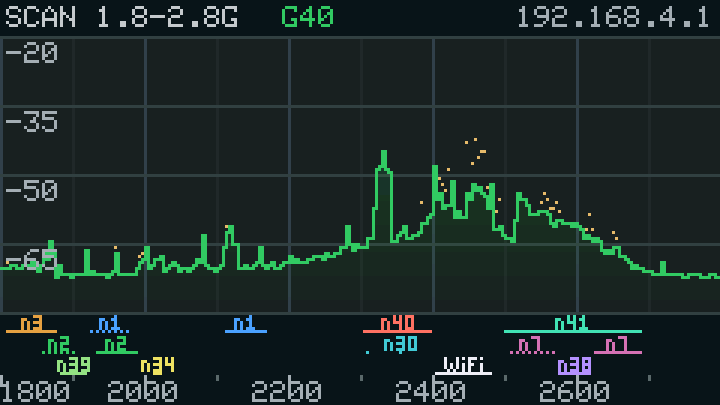

# TTGO T-Display · ESP32 SDR

基于 [ESPARGOS/esp-sdr](https://github.com/ESPARGOS/esp-sdr) 的 TTGO T-Display（ESP32 + 240×135 ST7789）频谱仪：

- **屏幕**：功率谱 / 瀑布图 / 上下分屏，按键切换；2.4G（2400–2500 MHz）、**2.3–2.5G**、**1.8–2.8G**、ch1/ch6/ch11 缩放；
  底部显示 **WiFi 信道 1–14 的编号和各自的频率区间线**（1.8–2.8G 视图改为显示 5G NR 频段 n1/n2/n3/n7/n30/n34/n38/n39/n40/n41 和 WiFi）
- **网页（WiFi）**：连热点 `TTGO-SDR`（密码 `ttgosdr123`），打开 <http://192.168.4.1> 就是**完整的
  [esp-web-sdr](https://github.com/ESPARGOS/esp-web-sdr) 页面**（原版 app.js / radio.js / 样式，只把 WebSerial 换成
  WebSocket），I/Q 捕获、片上频谱、瀑布、增益、带宽、缩放拖动全部可用，打开页面自动连接
- **USB**：UART0 上跑同一套 esp-sdr 协议（2 Mbaud），官方在线版
  <https://espargos.net/espsdr/app/>（Chrome，WebSerial）也能直接连这块板子

| 2.4G 全频段 | 2.3–2.5G 分屏 |
| --- | --- |
|  |  |
| **ch6 缩放** | **1.8–2.8G（NR 频段）** |
|  |  |

（截图是板子屏幕的真实像素，用 `tools/sdr_probe.py COM7 shot` 从设备读出。2.3–2.5G 图左边那块是本地 TD-LTE。）

## 按键

| 按键 | 短按 | 长按（>0.7 s） |
| --- | --- | --- |
| 左 GPIO0 | 频谱 → 瀑布 → 分屏 | 曲线平均：关 / 0.5 s / **1.5 s** / 4 s |
| 右 GPIO35 | 2.4G → 2.3–2.5G → 1.8–2.8G → ch1 → ch6 → ch11 | 增益：AGC / 20 / 30 / **40** / 50 / 60 / 70 |

设置保存在 NVS，断电不丢。网页或 USB 客户端占用射频时（5 秒无命令自动释放），屏幕改为显示客户端的频谱，
左上角显示 `WEB 2442/80M` 或 `USB ...`；此时按键改的本地设置在释放后生效。

### 信道条

图表下方：每个信道 1–14 的编号写在它的中心频率上（2412 + 5·(n−1) MHz，ch14 = 2484 MHz），下面是该信道 22 MHz
的区间线（ch1 = 2401–2423 MHz）。互相重叠的信道分到 5 行：{1,6,11} {2,7,12} {3,8,13} {4,9,14} {5,10}，同一行
互不重叠，编号和它的区间线同色。2.3–2.5G 视图里信道太密，编号改用 3×5 小字上下交错。

1.8–2.8G 视图不画 WiFi 信道，改为 NR 频段（3GPP TS 38.101-1）和 WiFi，分 3 道（标签在上、区间线在下），
每个频段一种颜色；FDD 频段上下行都画，**上行虚线、下行实线**：

| 频段 | 屏幕上的范围（MHz） |
| --- | --- |
| n3 | 下行 1805–1880（上行 1710–1785 在屏幕外） |
| n2 | 上行 1850–1910，下行 1930–1990 |
| n39 | 1880–1920（TDD） |
| n1 | 上行 1920–1980，下行 2110–2170 |
| n34 | 2010–2025（TDD） |
| n40 | 2300–2400（TDD） |
| n30 | 上行 2305–2315，下行 2350–2360（只在下行标一次） |
| WiFi | 2400–2483.5 |
| n41 | 2496–2690（TDD） |
| n7 | 上行 2500–2570，下行 2620–2690 |
| n38 | 2570–2620（TDD） |

### 1.8–2.8G 模式

40 个 LO（1815, 1840 … 2790 MHz，间隔 25 MHz），每列 4.2 MHz，每个 LO 每帧 3 个快照，约 2 帧/s。2210 MHz 以下用
esp-sdr 的 6/5 备用 LO 方案。esp-sdr 实测 ESP32 能收到信号的范围是 1850–2850 MHz，所以最左边几列可能没有真实信号。
本机实测能看到：2320–2370（TD-LTE B40）、2400–2483（WiFi）、2515–2675（TD-LTE B41）明显抬高，2110–2170
（B1 下行）也有起伏。

## 功率谱"跳动"的原因与修改（实测）

旧固件的问题，按影响大小：

1. **每个 LO 只取 1 个 1024 点 FFT（12.8 µs 的数据）**，每列再取 ~20 个 bin 的最大值。单次 FFT 每个 bin 是
   χ²(2) 分布（±5.6 dB），取最大值进一步放大波动
2. **频谱在每个 LO 两侧是镜像的**：没有像 esp-sdr 那样对 Q 取反（"正频率在 LO 上方"），8 个 LO 拼接时同一个信号
   在各 LO 落在不同的错误位置，max 合并后"鬼影"每帧乱跳
3. **硬件 AGC 每次捕获都在变，甚至在一次捕获中途改变**（每个样本 bit 27..20 的增益索引；实测约一半的捕获中途变了），
   8 个 LO 各自增益不同、不补偿
4. 缩放模式的 Hann 窗按 1024 点生成却用于 512 点 FFT，只用了半个窗（旁瓣泄漏严重）
5. 没有去直流，每个 LO 中心（每 10 MHz）一根本振泄漏尖峰
6. 显示：网页把 0.5 dB/码 当成 1 dB/码（波动显示放大一倍）；自动刻度每帧按 min/max 重算，整条曲线跟着"呼吸"；
   状态栏每帧先擦后画（闪烁）
7. 另外：`DUMP_STATUS` 寄存器地址写错（0x60033dc4 应为 0x60033d94），样本计数校验其实没生效

实测还发现：约 1–3% 的捕获**所有样本卡在同一个值**（I=−488, Q=−511），CRC 发现不了。新固件检测并重采。

在同一块板子、同一个办公室环境下用 `tools/sdr_probe.py COM7 jitter` 做 A/B（每列相邻两帧 dB 差的平均）：

| 情况 | 原始帧 | **屏幕上的曲线** | 帧率 |
| --- | --- | --- | --- |
| 旧固件：旧扫描 + AGC + 不平均 | 7.4 dB | **7.4 dB** | 9.9 |
| 新扫描 + AGC + 不平均 | 4.5 dB | 4.5 dB | 5.5 |
| **新固件默认：手动增益 40 + 平均 1.5 s** | 7.8 dB | **0.4–0.75 dB** | 5.5 |

折算到每秒，屏幕曲线从约 73 dB/s 降到约 3–4 dB/s。空闲频段（2486–2500 MHz）帧间波动的中位数为 1.0 dB，
四分位距从 5.6 dB 降到 1.6 dB。

为什么"原始帧"在 WiFi 频段降不下来：这是突发快照接收机的物理限制。每帧每个 LO 只能采几百 µs 的数据（占空比约
0.15%），WiFi 包恰好落在 0 个还是 3 个快照里，平均功率就能差 10 dB 以上（实测 ch1 附近单列帧间 ~18 dB，
2484 MHz 以上只有 2–3 dB）。所以新固件的做法是：

- **扫描**：每帧每个 LO 采 8 个分散在时间上的 2048 点快照（各切成 8 个 256 点 Hann FFT），去均值（去 LO 泄漏），
  Q 取反，跳过 LO ±1 MHz，滤波器边缘降权，列内取线性功率平均。时间分散比把数据堆在一次长快照里更有效
- **显示**：dB 域按真实时间常数平均（"视频平均"，默认 τ=1.5 s，与帧率无关），单个突发只会轻推曲线；
  峰值点（每秒回落 10 dB）和瀑布图保留原始帧，突发仍然看得见
- **自动刻度**：移植 esp-web-sdr 的"平稳"算法（每秒一次，地板 = 20% 分位 −10 dB 按 5 dB 步进 + 4 dB 迟滞，
  范围按 20 dB 取整），刻度不再每帧变
- **默认手动增益 40**：AGC 让曲线看起来更平，是因为它压缩了突发，但电平失去意义；长按右键可切回 AGC
- **画面**：整屏按 15 行一条在 sprite 里合成后推送，文字也画进 sprite，不闪烁

## 网页 / USB 的实现

- `web/esp-web-sdr/` 是上游原文件（`UPSTREAM.txt` 记录 commit）；`tools/build_web.py` 打补丁后 gzip 嵌入
  `src/web_assets.h`（约 113 KB）。补丁只有：用 `web/ws-transport.js` 替换 `serial-transport.js`、允许 http
  （设备热点上没有 HTTPS）、隐藏 WebSerial/WebUSB/刷机菜单、"kB/s WiFi" 标签。每个补丁都校验恰好命中一次，
  上游改了会构建失败而不是悄悄出错
- `ws-transport.js` 实现 radio.js 需要的串口子集（open/close/getInfo/setSignals + 字节流），`/ws` 双向都是原始字节流
- 固件端 `src/link.cpp` 按 esp-sdr 协议 6 / ESP32 配置实现：`INFO CAPS SYNC VERSION? TRANSPORT? RANGE? LIMITS?
  FREQ GAIN BANDWIDTH LPF DC CAP CAP16 CAP20 SPECINFO? SPEC BAUD RELEASE`，单客户端租约与上游一致
  （另一端收到 `ERR busy`，5 秒无命令释放）
- 与上游的差别：SPEC 每帧一次快照切成多个 FFT（帧头 FFT 计数如实填写）；每次捕获后把射频还给热点；
  失败的快照跳过而不是结束整个流
- 射频与热点共用：每次捕获前关 TX，捕获后 `rom_pbus_xpd_tx_on` + 回到 ch1、释放强制增益；WiFi 推流时 SPEC 帧间至少
  30 ms，给热点留发送时间

## 构建 / 烧录

```bash
cd ttgo-sdr
pio run                # 编译（web/ 有改动时自动重新生成 src/web_assets.h）
pio run -t upload      # 烧录（COM 口在 platformio.ini 改）
pio device monitor     # 2 Mbaud；有协议客户端连着 USB 时日志自动静默
```

平台：pioarduino（arduino-esp32 3.x / ESP-IDF 5.x，自带 esp-dsp 和带 WebSocket 的 esp_http_server），
屏幕驱动最新 TFT_eSPI，全部用 build_flags 配置。

## 测试工具（`tools/`，都不需要连板子的热点）

| 命令 | 作用 |
| --- | --- |
| `python tools/sdr_probe.py COM7 protocol` | 按 radio.js 的顺序协商，CAP16/CAP20 校验 CRC，三种采样率的 SPEC 帧/SPS1/SPECEND 校验 |
| `python tools/sdr_probe.py COM7 jitter` | 上面那张 A/B 表 |
| `python tools/sdr_probe.py COM7 shot x.png` | 读出屏幕真实像素存成 PNG |
| `python tools/build_web.py --dist build/web` + `python tools/ws_bridge.py COM7 build/web 18765` | 在 <http://localhost:18765> 用 WebSocket→USB 桥打开同一个网页 |
| `node tools/web_radio_test.mjs build/web ws://127.0.0.1:18765/ws` | 用上游 radio.js + ws-transport.js 在 Node 里无头跑一遍 |

扩展命令（不占租约，USB 上可用）：`TTGO STAT?`（抖动、帧时间、卡死捕获数、堆、栈余量）、
`TTGO LOCAL band agc gain legacy`、`TTGO VIEW n`、`TTGO AVG n`、`TTGO FRAME?`、`TTGO SHOT?`。
`legacy=1` 用旧固件的扫描算法，专门做 A/B 对比。

## 实测状态（本机 TTGO T-Display，COM7，2026-10-19）

- 协议探针连续 5 轮 23/23 通过；上游 radio.js 经 WebSocket 桥全部通过（I/Q 8/10 bit、SPEC 80/40/16 MS/s 约
  100 帧/s、CRC 错误 0）
- 2 分钟高频切模式压力测试：45221 次捕获 0 错误、0 重启，卡死捕获 1.3% 全部重采成功；空闲堆约 26 KB
- 帧率：2.4G 扫描 5.4 帧/s，2.3–2.5G 2.4 帧/s（18 个 LO），1.8–2.8G 2.1 帧/s（40 个 LO），信道缩放 19.6 帧/s；
  屏幕曲线帧间变化分别为 0.71 / 1.03 / 0.53 / 0.23 dB

**未在真机验证**：WiFi 上的网页（本机只有一块无线网卡，连热点会断开工作网络）。WebSocket 路径用的
radio.js/ws-transport.js 已经过桥接实测；固件里的 httpd 收发部分核对过 IDF 库的实现，但没有在手机/电脑上实际打开过
192.168.4.1。第一次用请留意。

## 已知限制

- 没有移植 esp-sdr 的换频重校准（它改写的 PHY 私有数据与 Arduino core 的 PHY 库布局不一致）。非信道频点
  （2.3–2.4G、1.8–2.8G 扫描）直接用 ROM PLL 换频，直流靠去均值处理；网页可用的频率范围设为 1850–2850 MHz
  （esp-sdr 实测 ESP32 范围）
- 功率是 dBFS（与 esp-web-sdr 同一标度），没有绝对校准；增益是 PHY 表索引，不是 dB
- 热点与 SDR 共用一个射频：推流时 AP 会周期性丢一些信标，TCP 会重传；I/Q 模式每次 40 KB，比片上频谱模式慢

## 目录

```
ttgo-sdr/
├── platformio.ini
├── src/
│   ├── main.cpp          # 启动顺序：屏幕 → 热点 → 射频 → 引擎 → Web
│   ├── sdr_rx.c/.h       # esp-sdr ESP32 捕获后端（与热点共用射频、卡死检测）
│   ├── dsp.c/.h          # Welch 频谱（esp-dsp），esp-sdr 的功率编码与 dBFS 标度
│   ├── engine.c/.h       # 射频所有者任务：本地扫描/缩放、帧邮箱、抖动统计
│   ├── link.cpp/.h       # esp-sdr 协议（UART + WebSocket），租约，TTGO 扩展命令
│   ├── ui_tft.cpp/.h     # 屏幕：频谱/瀑布/分屏、信道条、按键
│   ├── web_server.cpp/.h # esp_http_server：网页资源、/ws、/api/status
│   └── web_assets.h      # 生成文件（tools/build_web.py）
├── web/
│   ├── esp-web-sdr/      # 上游原文件（GPL-3.0）
│   └── ws-transport.js   # WebSocket 版传输层
├── docs/                 # 屏幕截图
└── tools/                # 构建脚本、协议探针、桥接、Node 测试
```

本固件为 **GPL-3.0-or-later**（派生自 esp-sdr，网页为 esp-web-sdr），见 `LICENSE-NOTE`。
